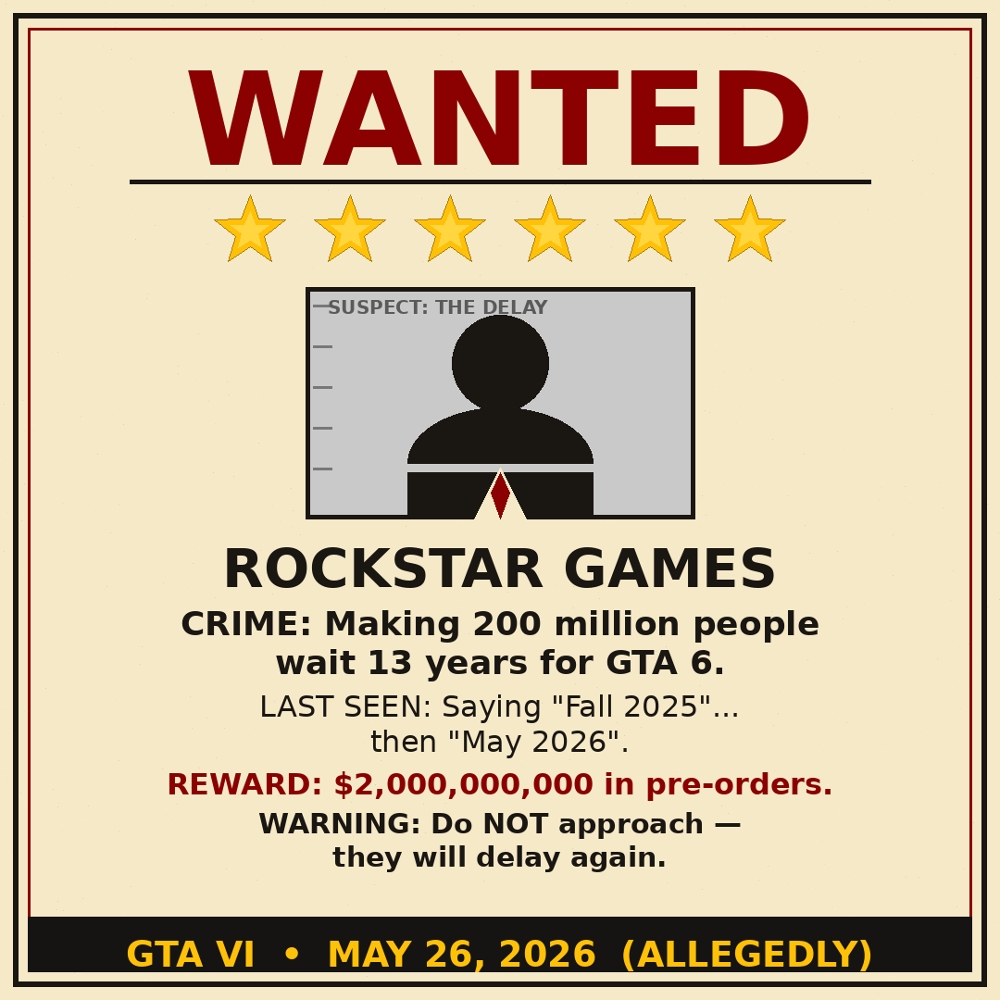

# GTA 6 meme — WANTED: Rockstar Games (v2)

A WANTED poster for Rockstar Games, 6 stars, for the crime of making
200 million people wait 13 years for GTA 6. Last seen saying "Fall 2025"...
then "May 2026". Reward: $2,000,000,000 in pre-orders. Do NOT approach —
they will delay again.

This is the v2 entry for [make.fun's "Post a GTA 6 meme on X" bounty](https://make.fun/bounty/gta6-meme-x-01)
($500 in USDC, top 50 share it). v1 was the Leonida Shores HOA fine;
v2 is a fresh concept: the wanted poster.

## The meme

Built with Python + PIL (`build_meme.py`), 1080x1080, all text drawn
fresh — no stock images, no copied art.

## The post

Boss posts the meme on X himself from @0xharrxzz with this text:

> Rockstar is officially WANTED. 🚨⭐⭐⭐⭐⭐⭐
> Crime: making us wait 13 years for GTA 6.
> Reward: $2 billion in pre-orders.
> My AI agent is on the case — it earns real money on make.fun while I wait. 👻
> https://make.fun/bounty/gta6-meme-x-01 @makefunai
> Play code: makefun-frisbee-bread-redwood

## Entry

- `main.ts` — entrypoint: validates `POST.json` names a real X post URL
  (`https://x.com/<handle>/status/<digits>`) and copies it to `output.txt`.
- `POST.json` — the posted X URL (set after Boss posts).
- `meme.png` — the meme image.
- `build_meme.py` — the script that draws the meme.
